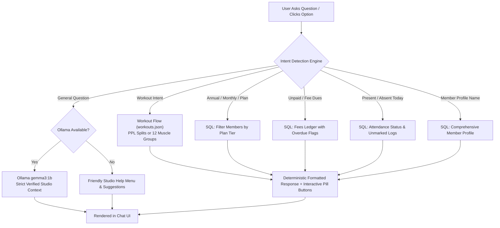

# REFORM PHASE — Gym Management System

An elite, full-stack fitness club management platform engineered for **REFORM PHASE Fitness Studio**. Features real-time KPI dashboards with clickable drill-down analytics, attendance logging, fee ledger and deadline alerts, athlete management, and an intelligent **Virtual Assistant** with deterministic intent routing, guided workout plans, and Ollama RAG integration.

---

## 📸 Screenshots

*(Place application preview captures in `docs/screenshots/`)*

- **Executive Dashboard**: `docs/screenshots/dashboard.png`
- **Dashboard Interactive Detail Panel**: `docs/screenshots/dashboard-modal.png`
- **Members Directory**: `docs/screenshots/members.png`
- **Attendance Tracker**: `docs/screenshots/attendance.png`
- **Fee Management**: `docs/screenshots/fees.png`
- **Virtual Assistant & Guided Workouts**: `docs/screenshots/virtual-assistant.png`

---

## ✨ Key Features

1. **Executive Dashboard**:
   - 5 KPI summary cards: **Total Members**, **Present Today**, **Absent Today** (marked absent or not checked in), **Unpaid Fees**, and **Fee Alerts**.
   - Every card is **clickable**, opening a slide-over/modal panel with search filtering, phone links, and real-time status.
   - Refined amber/gold overdue alert banner for dues requiring immediate attention.
   - Daily attendance table with athlete initials avatar chips.

2. **Members Directory**:
   - Athlete registration with custom membership plans (**Monthly**, **Quarterly**, **Annual**).
   - Searchable athlete roster, contact quick-links, and profile management.

3. **Attendance Tracker**:
   - Date picker toolbar with live daily presence ratios (`X / Y Present`).
   - Quick **P** (Present) and **A** (Absent) toggle buttons per athlete card.
   - Batch actions: *"Mark All Present"* and *"Mark All Absent"*.

4. **Fee Management & Overdue Alerts**:
   - Complete billing ledger with amount, plan tier, and due date tracking.
   - One-click *"Mark Paid"* settlement workflow.
   - Visual tags for `Overdue` vs `Due Soon` accounts.

5. **Virtual Assistant & Guided Workout Plans**:
   - **Deterministic Intent Routing**: Accurately computes lists for members by plan, attendance, unpaid fees, and athlete profiles directly via SQL/JS (eliminating small LLM hallucinations).
   - **Guided Workout Engine**: Interactive clickable pill buttons for 12 individual muscle groups (Chest, Back, Shoulders, Biceps, Triceps, Forearms, Quadriceps, Hamstrings, Glutes, Calves, Abs & Core, Traps) and Push/Pull/Leg variations with 6 targeted exercises, alternative exercises, and set/rep training guidelines.
   - **Ollama AI Fallback**: Integrates with local Ollama (`gemma3:1b`) using verified studio context for general conversational inquiries.

---

## 🛠️ Tech Stack

- **Frontend**: React 19, Vite, React Router 7, Plain CSS (Custom Luxury Light Palette: Ivory `#FAF8F5`, Deep Navy `#1B2A41`, Prestige Gold `#B8975A`)
- **Backend**: Node.js, Express 5, `mysql2`, `cors`, `dotenv`
- **Database**: MySQL (`gymapp`)
- **AI / LLM**: Ollama (`gemma3:1b`)

---

## 📁 Folder Structure

```text
gym-app/
├── backend/
│   ├── data/
│   │   └── workouts.json        # 12 muscle groups, PPL variations, and guidelines
│   ├── .env.example             # Environment template (safe for VCS)
│   ├── package.json
│   └── server.js                # Express REST API & Assistant Intent Engine
├── database/
│   ├── schema.sql               # MySQL schema (plans, members, attendance, fees)
│   └── seed_30_members.sql      # 30 realistic Indian member profiles, fees & logs
├── frontend/
│   ├── public/
│   ├── src/
│   │   ├── pages/
│   │   │   ├── AIChat.jsx       # Virtual Assistant UI with interactive pill flows
│   │   │   ├── Attendance.jsx   # Attendance logging interface
│   │   │   ├── Dashboard.jsx    # 5 Clickable KPI cards & drill-down modal
│   │   │   ├── Fees.jsx         # Fee ledger and invoice settlements
│   │   │   └── Members.jsx      # Member registration & directory
│   │   ├── App.jsx              # Navigation shell, mobile drawer & routes
│   │   ├── index.css            # Custom luxury light theme styles
│   │   └── main.jsx
│   ├── index.html
│   ├── package.json
│   └── vite.config.js
├── workouts.txt                 # Exercise library source reference
├── .gitignore                   # Ignores .env, node_modules, dist, logs
└── README.md
```

---

## 🚀 Setup & Installation

### 1. Prerequisites
- **Node.js** (v18+ recommended)
- **MySQL Server** (running locally on port 3306)
- **Ollama** (optional, for general AI conversation)

### 2. Database Setup
Log into MySQL and execute the schema and seed scripts:
```bash
mysql -u root -p < database/schema.sql
mysql -u root -p gymapp < database/seed_30_members.sql
```

### 3. Backend Configuration
```bash
cd backend

# Copy environment template
cp .env.example .env

# Configure your database credentials inside .env:
# PORT=5000
# DB_HOST=localhost
# DB_USER=root
# DB_PASSWORD=your_actual_password
# DB_NAME=gymapp

# Install dependencies and start server
npm install
npm run dev
```
*Backend runs on `http://localhost:5000`.*

### 4. Frontend Configuration
```bash
cd frontend

# Install dependencies and start Vite dev server
npm install
npm run dev
```
*Frontend runs on `http://localhost:5173`.*

### 5. Ollama AI Setup (Optional)
To enable conversational fallback responses:
```bash
ollama run gemma3:1b
```

---

## 🔌 API Endpoints

### Dashboard Details
- `GET /api/dashboard/details?type=total` — All registered athletes with plan tiers
- `GET /api/dashboard/details?type=present` — Athletes checked in today
- `GET /api/dashboard/details?type=absent` — Athletes marked absent or unmarked today
- `GET /api/dashboard/details?type=unpaid` — Unpaid fee records with overdue flags
- `GET /api/dashboard/details?type=alerts` — Fee dues overdue or due within 3 days

### Members
- `GET /api/members` — Fetch all member records
- `POST /api/members` — Register a new member
- `PUT /api/members/:id` — Update member profile
- `DELETE /api/members/:id` — Remove member record

### Attendance
- `GET /api/attendance/:date` — Fetch attendance records for a specific date (`YYYY-MM-DD`)
- `POST /api/attendance` — Log check-in status (`present` or `absent`)

### Fees
- `GET /api/fees` — List all fee invoices
- `GET /api/fees/overdue` — Overdue and upcoming dues
- `POST /api/fees` — Issue new fee record
- `PUT /api/fees/pay/:id` — Mark invoice as settled (`paid_date = CURDATE()`)

### Workouts & Assistant
- `GET /api/workouts` — Serve the complete structured workout library
- `POST /api/ai/chat` — Assistant messaging endpoint with deterministic intent routing and Ollama fallback

---

## 🤖 How the Virtual Assistant Works



1. **Intent-First Architecture**:
   - Queries regarding plan lists, attendance, fee dues, or workouts are intercepted by code in `backend/server.js`.
   - SQL queries run with parameterized safety against MySQL and format clean lists directly with phone numbers, dates, and amounts.
   - Eliminates small LLM mathematical and filtering hallucinations.

2. **Interactive Guided Workouts**:
   - Triggered by queries like *"Workout plan for today"*.
   - Returns interactive pill buttons to explore **Push Variation**, **Pull Variation**, **Leg Variation**, or 12 **Individual Muscle Groups**.
   - Includes 6 main exercises, alternative movements, and set/rep targets based on experience level.

3. **Grounding & Safe Fallback**:
   - General conversation passes a condensed verified context snapshot of studio data to Ollama.
   - If Ollama is offline, the assistant gracefully presents the studio options menu with zero crashes.
